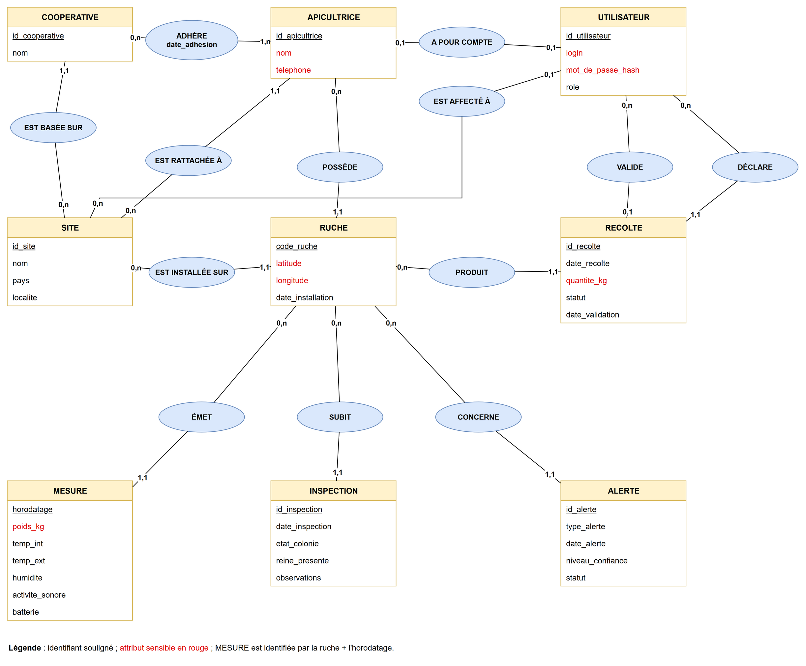

# Queen Bee · Modèle de données annoté

> **TP Jour 1 · Base de données · M1 Cyber**
> Groupe : Killian Morvan
> Livrables 1 et 2 : le MCD annoté (lab 1) et le schéma relationnel (lab 2)
> Fichiers liés : `mcd.drawio`, `mcd.png`, `schema.sql`, `donnees.sql`, `tests_schema.sql`

## Sommaire

- [Lab 1 · Modèle entité-association](#lab-1--modèle-entité-association)
  - [Q1. Les entités](#q1-de-quoi-le-système-doit-il-se-souvenir-)
  - [Q2. Attributs et identifiants](#q2-que-garde-t-on-sur-chacune-et-quest-ce-qui-la-distingue-)
  - [Q3. Les liens](#q3-comment-sont-elles-liées-)
  - [Q4. Les hypothèses](#q4-ce-que-le-sujet-ne-dit-pas)
  - [Q5. Ce qui intéresse un fraudeur](#q5-ce-qui-intéresserait-un-voleur-ou-un-fraudeur)
  - [Le MCD](#le-mcd)
  - [Partie C. Sensibilité et menaces](#partie-c-sensibilité-et-menaces-stride)
- [Lab 2 · Schéma relationnel](#lab-2--schéma-relationnel)

---

# Lab 1 · Modèle entité-association

## Q1. De quoi le système doit-il se souvenir ?

**9 entités :**

| Entité | Équivalent GreenFarm |
|---|---|
| SITE | exploitation |
| RUCHE | serre |
| APICULTRICE | exploitant |
| COOPÉRATIVE | groupement |
| MESURE | relevé |
| INSPECTION | intervention |
| UTILISATEUR | compte |
| **RÉCOLTE** | *aucun* |
| **ALERTE** | *aucun* |

Les deux entités sans équivalent dans GreenFarm :

- **RÉCOLTE** : l'apicultrice déclare sa récolte, puis un coordinateur la valide. La valeur économique repose sur cette quantité, donc aussi la fraude. Il faut garder qui a déclaré, qui a validé, et quand.
- **ALERTE** : le système détecte des événements (essaimage, vol, capteur silencieux) avec un niveau de confiance. Il faut les garder pour réagir, puis pour prouver ce qui s'est passé.

Ne sont **pas** des entités : le pays (une information sur le site), le poids ou la température (des informations sur la mesure), le rôle (une information sur l'utilisateur).

## Q2. Que garde-t-on sur chacune, et qu'est-ce qui la distingue ?

| Entité | Ce qu'on garde | Identifiant |
|---|---|---|
| site | nom, pays, localité | son code (`SN-CASA`) |
| ruche | code, latitude, longitude, date d'installation | son code (`SN-CASA-014`) |
| apicultrice | nom, téléphone | un numéro attribué |
| coopérative | nom | un numéro attribué |
| mesure | horodatage, poids, températures, humidité, activité sonore, batterie | la ruche + l'horodatage |
| inspection | date, état de la colonie, reine présente, observations | un numéro attribué |
| récolte | date, quantité, statut, date de validation | un numéro attribué |
| alerte | type, date, niveau de confiance, statut | un numéro attribué |
| utilisateur | login, empreinte du mot de passe, rôle | un numéro attribué |

> **Pourquoi pas le nom pour l'apicultrice ?** Deux apicultrices s'appellent « Aminata Diop ». Le nom n'est pas unique et peut changer.

## Q3. Comment sont-elles liées ?

| Lien | Dans un sens | Dans l'autre sens |
|---|---|---|
| ruche – apicultrice | une ruche appartient à **une seule** apicultrice | une apicultrice possède **zéro ou plusieurs** ruches |
| ruche – site | une ruche est installée sur **un seul** site | un site accueille **zéro ou plusieurs** ruches |
| apicultrice – site | une apicultrice est rattachée à **un seul** site | un site a **zéro ou plusieurs** apicultrices |
| apicultrice – coopérative | une apicultrice adhère à **au moins une** coopérative | une coopérative a **zéro ou plusieurs** adhérentes |
| coopérative – site | une coopérative est basée sur **un seul** site | un site a **zéro ou plusieurs** coopératives |
| ruche – mesure | une mesure vient d'**une seule** ruche | une ruche émet **zéro ou plusieurs** mesures |
| ruche – inspection | une inspection porte sur **une seule** ruche | une ruche subit **zéro ou plusieurs** inspections |
| ruche – récolte | une récolte vient d'**une seule** ruche | une ruche produit **zéro ou plusieurs** récoltes |
| ruche – alerte | une alerte concerne **une seule** ruche | une ruche a **zéro ou plusieurs** alertes |
| compte – récolte (déclare) | une récolte est déclarée par **un seul** compte | un compte déclare **zéro ou plusieurs** récoltes |
| compte – récolte (valide) | une récolte est validée par **au plus un** compte | un compte valide **zéro ou plusieurs** récoltes |
| compte – site | un compte est affecté à **au plus un** site | un site a **zéro ou plusieurs** comptes |
| apicultrice – compte | une apicultrice a **au plus un** compte | un compte appartient à **au plus une** apicultrice |

## Q4. Ce que le sujet ne dit pas

| Question au client | Notre hypothèse |
|---|---|
| Une ruche peut-elle changer de site ? | Oui (transhumance), mais on ne garde que le site actuel. |
| Une ruche peut-elle changer de propriétaire ? | Oui, mais on ne garde que l'apicultrice actuelle. |
| Qui valide une récolte ? | Un coordinateur, pour les ruches de son site. Jamais la déclarante. |
| Une récolte refusée peut-elle être redéclarée ? | Non. L'apicultrice fait une nouvelle déclaration. |
| Un coordinateur gère-t-il plusieurs sites ? | Non, un seul. |
| Garde-t-on qui a traité une alerte ? | Pas encore : seulement son statut (ouverte / traitée). |
| Qui fait les inspections ? | L'apicultrice propriétaire de la ruche. |
| Un capteur peut-il changer de ruche ? | Non : la mesure est rattachée à la ruche, pas au capteur. |

## Q5. Ce qui intéresserait un voleur ou un fraudeur

| Information | Ce qu'il en ferait |
|---|---|
| **Position GPS des ruches** | Aller voler les ruches, surtout les plus isolées. |
| **Quantité et validation des récoltes** | Gonfler une récolte, ou la faire valider par un complice, pour toucher plus d'argent. |
| **Nom et téléphone des apicultrices** | Démarchage, hameçonnage, pression sur des personnes isolées. |
| **Login et mot de passe** | Se connecter comme coordinateur pour valider de fausses récoltes, ou comme admin pour effacer les traces. |

## Le MCD



- 9 entités, chacune avec son identifiant souligné.
- 13 associations, avec deux cardinalités par trait.
- **ADHÈRE** porte `date_adhesion` : c'est le seul lien n,n.
- **VALIDE** et **DÉCLARE** relient UTILISATEUR et RÉCOLTE.
- Les attributs sensibles sont **en rouge** : nom, téléphone, GPS, poids, quantité, login, mot de passe.

## Partie C. Sensibilité et menaces (STRIDE)

**Rôles :** API = apicultrice · COO = coordinateur de site · GES = gestionnaire · ADM = administrateur

### Qui accède à quoi

| Entité | Sensibilité | Qui lit | Qui modifie |
|---|---|---|---|
| RUCHE | confidentielle (GPS) | API (les siennes), COO (son site), GES, ADM | COO, ADM |
| SITE | interne | tous | GES, ADM |
| APICULTRICE | confidentielle (RGPD) | elle-même, COO (son site), GES, ADM | elle-même, GES, ADM |
| COOPÉRATIVE | interne | tous | GES, ADM |
| MESURE | interne | API (ses ruches), COO, GES | les capteurs (ajout seulement) |
| INSPECTION | interne | API (ses ruches), COO, GES | API (les siennes) |
| RÉCOLTE | **critique** | API (les siennes), COO (son site), GES | API (déclare), COO (valide) |
| ALERTE | interne | API (ses ruches), COO, GES | le système, COO (statut) |
| UTILISATEUR | **critique** | ADM, chacun son propre compte | ADM |
| *Journal des actions* | **critique** | ADM (lecture seule) | personne (ajout seulement) |

### Les menaces

| Entité | STRIDE | Ce que gagne l'attaquant |
|---|---|---|
| RUCHE | **I** | Connaître la position GPS pour voler la ruche. |
| SITE | **T** | Changer le site d'une ruche pour masquer un vol. |
| APICULTRICE | **I** | Récupérer noms et téléphones pour l'hameçonnage. |
| COOPÉRATIVE | **T** | Ajouter une fausse adhésion pour toucher des aides. |
| MESURE | **T**, **S** | ⚠️ **Mesure rejouée** : renvoyer un ancien poids cache un vol ou un essaimage. Un faux capteur envoie des mesures au nom d'une ruche. |
| INSPECTION | **R**, **T** | L'apicultrice nie avoir vu l'absence de reine, ou une fausse inspection couvre une ruche abandonnée. |
| RÉCOLTE | **R**, **E** | ⚠️ **Récolte validée sans qu'on sache par qui** : personne n'est responsable d'une quantité gonflée. Une apicultrice valide sa propre récolte. |
| ALERTE | **D**, **T** | Faire taire les alertes pendant un vol, ou baisser leur niveau de confiance. |
| UTILISATEUR | **S**, **E** | Se connecter à la place d'un coordinateur, ou se donner le rôle admin. |
| *Journal des actions* | **R**, **T** | ⚠️ **Effacement de l'historique** : nier avoir validé ou supprimé quoi que ce soit. |

Les 6 lettres STRIDE sont couvertes : **S T R I D E**.

## Testez-vous · Lab 1

1. **La date d'adhésion appartient à qui ?**
   Au **lien** ADHÈRE : une apicultrice adhère à plusieurs coopératives, à des dates différentes.
2. **Pourquoi le nom est-il un mauvais identifiant ?**
   Il n'est pas unique (homonymes), il peut changer, et c'est une donnée personnelle qu'on ne veut pas recopier partout.
3. **Quelle lettre STRIDE pour le rejeu d'un ancien poids ?**
   **T** (altération), et **S** si l'attaquant se fait passer pour le capteur.
4. **« Une ruche appartient à une seule apicultrice » : quelle cardinalité ?**
   **1,1 du côté de RUCHE** (et 0,n du côté d'APICULTRICE).

---

# Lab 2 · Schéma relationnel

## Les 10 tables

Notation : la clé primaire est la première colonne (`id`, sauf pour `adhesion`), et `#` marque une clé étrangère.

```text
site        (id, nom, pays, localite)
cooperative (id, nom, #site_id)
apicultrice (id, nom, telephone, #site_id)
ruche       (id, code UNIQUE, latitude, longitude, date_installation, #site_id, #apicultrice_id)
adhesion    (#apicultrice_id, #cooperative_id, date_adhesion)          -- clé = les deux
utilisateur (id, login, mot_de_passe_hash, role, #site_id, #apicultrice_id UNIQUE)
mesure      (id, #ruche_id, horodatage, poids_kg, temp_int_c, temp_ext_c,
             humidite_pct, activite_sonore_db, batterie_pct)            -- UNIQUE (ruche_id, horodatage)
inspection  (id, #ruche_id, date_inspection, etat_colonie, reine_presente, observations)
recolte     (id, #ruche_id, date_recolte, quantite_kg, statut,
             #declaree_par, #validee_par, date_validation)
alerte      (id, #ruche_id, type_alerte, date_alerte, niveau_confiance, statut)
```

> **Résultat : 10 tables, 14 clés étrangères.**

## Les 4 règles appliquées

| Règle | Ce qu'on en fait |
|---|---|
| **1.** Une entité devient une table | Le site garde un code lisible (court, stable, pas secret). Tout ce que l'application exposera reçoit un **UUID**, car un numéro 1, 2, 3 se devine. |
| **2.** Un lien 1,1 – 0,n devient une clé étrangère | Côté 1,1 : `ruche.site_id`, `ruche.apicultrice_id`, `mesure.ruche_id`... |
| **3.** Un lien n,n devient une table | ADHÈRE devient `adhesion`, avec une clé sur deux colonnes et `date_adhesion`. |
| **4.** Un lien 0,1 – 0,1 devient une clé étrangère UNIQUE | `utilisateur.apicultrice_id UNIQUE` : jamais deux comptes pour une apicultrice. |

Les deux liens entre UTILISATEUR et RÉCOLTE deviennent `declaree_par` et `validee_par`, qui pointent tous deux vers `utilisateur`.

## Les règles de sécurité de `schema.sql`

| Contrainte | Ce qu'elle empêche |
|---|---|
| `mesure_anti_rejeu` | rejouer une mesure (même ruche, même instant) |
| `recolte_quantite_positive` | une quantité nulle ou négative |
| `recolte_validation_tracee` | une récolte validée sans validateur ni date |
| `recolte_pas_auto_validation` | valider sa propre récolte |
| `alerte_confiance_bornee` | un niveau de confiance hors de [0, 1] |
| `CHECK` sur `utilisateur` | un compte « apicultrice » sans apicultrice, ou un coordinateur sans site |

## Le jeu d'essai

| Comptage | Attendu | Obtenu |
|---|---|---|
| ruches | 11 | ✅ 11 |
| mesures | 528 (11 × 48) | ✅ 528 |
| adhésions | 8 | ✅ 8 |
| comptes | 10 | ✅ 10 |

**Que se passe-t-il si on relance `donnees.sql` sans `schema.sql` ?**

```text
ERREUR: la valeur d'une clé dupliquée rompt la contrainte unique « site_pkey »
DÉTAIL : La clé « (id)=(SN-CASA) » existe déjà.
```

Toute la transaction est annulée (`BEGIN … COMMIT`), et rien n'est doublé : il y a toujours 11 ruches. Ce qui protège la base :

1. la **clé primaire de `site`**, un code stable d'un lancement à l'autre ;
2. l'**atomicité de la transaction** : tout passe, ou rien ne passe.

## La base dans pgAdmin (étape 2.4)

- **Tables** : `queenbee > Schemas > public > Tables` affiche les 10 tables. *View/Edit Data* sur `ruche` affiche les 11 ruches avec leurs UUID.
- **ERD For Database** : chaque association du MCD est un trait, et ADHÈRE est la table `adhesion`. On retrouve le MCD.
- **Query Tool** : la requête sur `pg_constraint` renvoie les **14 clés étrangères** du schéma `public`, toutes en `_fk`.

> Lancée après le lab 5, la requête affiche 17 lignes : les 3 de plus sont celles des tables `norm`.

## Testez-vous · Lab 2

1. **Où met-on la clé étrangère d'un lien 1,1 – 0,n ?**
   Du côté **1,1** : par exemple, la ruche porte `apicultrice_id`.
2. **Pourquoi une table d'association a-t-elle une clé sur deux colonnes ?**
   Une adhésion est identifiée par le **couple** (apicultrice, coopérative). Chaque colonne seule se répète, mais le couple ne doit apparaître qu'une fois.
3. **Que protège `UNIQUE (ruche, horodatage)` ?**
   Le **rejeu** d'une ancienne mesure pour masquer une chute de poids (menace T).
4. **Pourquoi écrire `site` avant `ruche` ?**
   Parce que `REFERENCES site(id)` exige que la table visée existe déjà.
