# TP Jour 2 - Labs 6 et 7 - Killian Morvan

Notre base du jour 1 est utilisée : Fatou Ba du sujet = Awa Diop (+221 77 000 01 02, ruche SN-CASA-030), SN-CASA-011 = SN-CASA-021.

## Lab 6 - Décomposer sans rien perdre

### 6.1 Analyser la table reçue

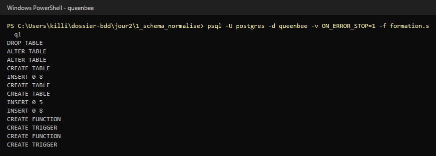

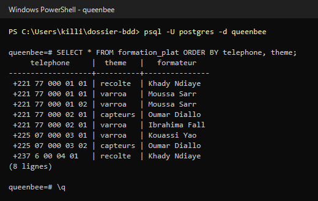

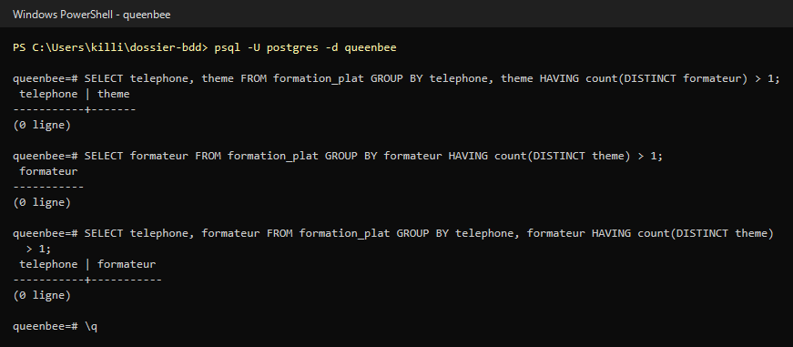

Dépendances : (telephone, theme) → formateur, et formateur → theme.

Clés candidates : (telephone, theme) et (telephone, formateur).

3NF : oui, les trois colonnes font partie d'une clé candidate. BCNF : non, formateur → theme part de formateur, qui n'est pas une clé.

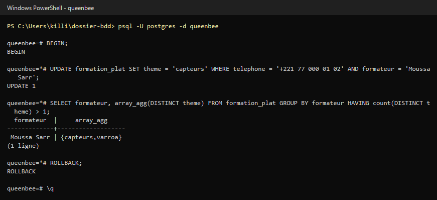

Anomalie : la table accepte que Moussa Sarr enseigne deux thèmes, sans aucun message.

### 6.2 Découper, et prouver qu'on n'a rien perdu

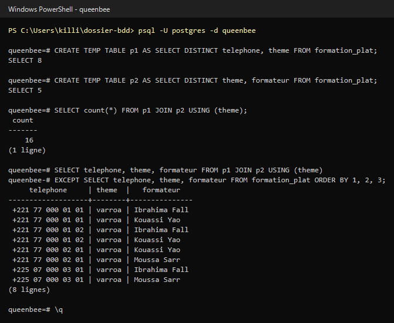

16 lignes au lieu de 8, dont 8 inventées : la colonne commune, theme, n'est la clé d'aucun des deux morceaux, car un thème a plusieurs formateurs. Awa Diop serait suivie par trois formateurs varroa.

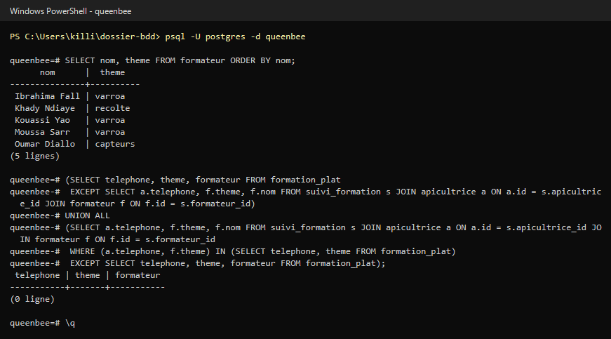

Bon découpage : 5 formateurs, 8 suivis, 0 ligne de différence.

La contrainte UNIQUE sur formateur.nom garantit formateur → theme : un formateur n'a qu'une ligne, donc un seul thème.

suivi_formation pointe vers apicultrice(id) au lieu de recopier le téléphone, parce que le téléphone peut changer et que c'est une donnée personnelle. Pour que la jointure par téléphone retrouve une seule apicultrice, formation.sql pose UNIQUE (telephone) sur apicultrice.

### 6.3 La règle perdue, et le trigger qui la rétablit

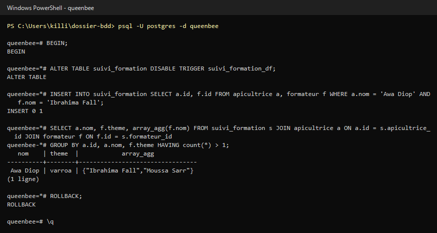

Sans trigger, Awa Diop peut avoir deux formateurs varroa : plus aucune table ne contient à la fois l'apicultrice et le thème.

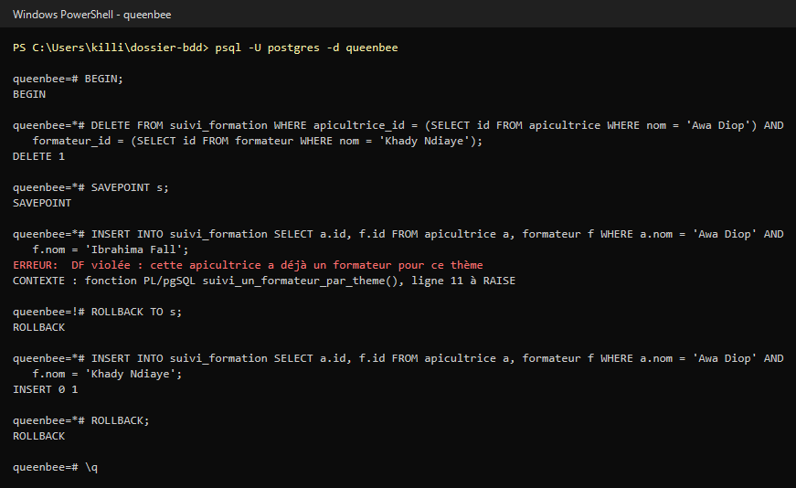

Avec le trigger : Ibrahima Fall (varroa) est refusé, Khady Ndiaye (récolte) est accepté. Le trigger ignore aussi l'ancienne ligne lors d'un UPDATE (changer de formateur dans le même thème est accepté), et un second trigger refuse qu'un formateur change de thème si l'une de ses apicultrices a déjà un formateur pour ce thème (Khady Ndiaye en varroa : refusé). Les tests sont dans tests_formation.sql.

Pour aller plus loin : en recopiant theme dans suivi_formation, avec UNIQUE (apicultrice_id, theme) et une clé étrangère (formateur_id, theme), la table n'est plus en BCNF (formateur_id → theme), mais elle reste en 3NF. La copie ne peut pas diverger.

### 6.4 Relire tout le schéma

site, cooperative, apicultrice, adhesion, mesure, inspection, recolte, alerte, formateur, suivi_formation : chaque dépendance part de la clé primaire ou d'une colonne UNIQUE. La partie gauche est une super-clé : BCNF.

formation_plat : formateur → theme ne part pas d'une clé, donc pas BCNF. C'est la table d'import, laissée telle quelle.

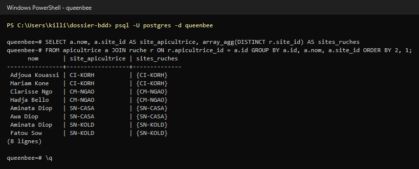

Chaque apicultrice n'a de ruches que sur son site. C'est une règle métier : une apicultrice est rattachée à un site, et le coordinateur valide les récoltes de son site. Elle est garantie par la clé étrangère composée (apicultrice_id, site_id) vers apicultrice (id, site_id), ajoutée au Lab 10.

### Testez-vous - Lab 6

1. (A, B) + (A, C) est sans perte : la colonne commune A est la clé de (A, B). (A, B) + (B, C) n'est pas garanti : B n'est la clé d'aucun morceau.

2. La 3NF accepte X → A quand A fait partie d'une clé candidate : theme fait partie de la clé (telephone, theme).

3. Sans s.formateur_id <> NEW.formateur_id, le trigger trouverait la ligne même qu'on écrit et refuserait à tort. Mais ça ne suffit pas : en changeant de formateur dans le même thème, l'ancienne ligne est encore en table pendant l'UPDATE, il faut donc aussi exclure OLD. Et un UPDATE du thème dans formateur a son propre trigger.

4. Rester en 3NF : avantage, toutes les règles sont garanties par des clés, sans trigger. Inconvénient, la redondance reste, avec l'anomalie de mise à jour.

## Lab 7 - Dénormaliser, en connaissance de cause

### 7.1 Mesurer avant de copier

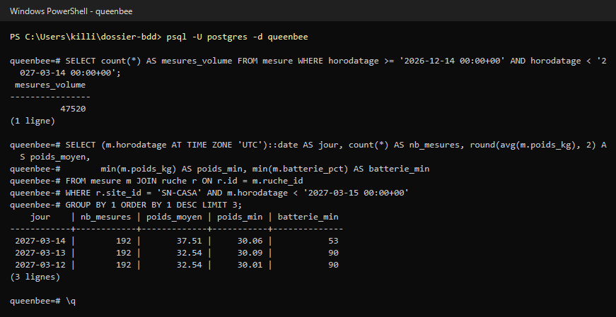

volume.sql : INSERT 0 47520 (11 ruches x 4 320 mesures). Tableau de bord : 192 mesures par jour (4 ruches x 48).

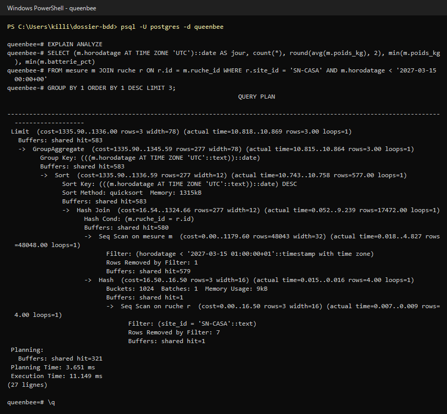

Execution Time de la requête sur la table mesure : 10,6 ms.

### 7.2 La synthèse, et son prix

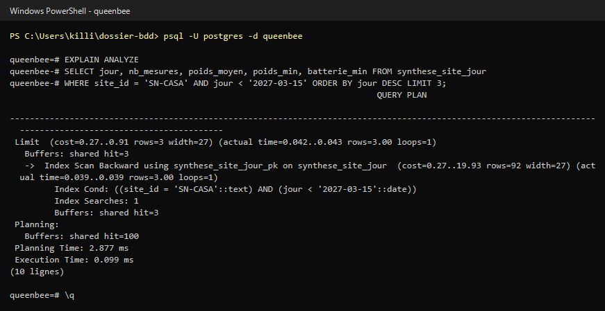

Mêmes chiffres dans la vue matérialisée : 0,06 ms au lieu de 10,6 ms.

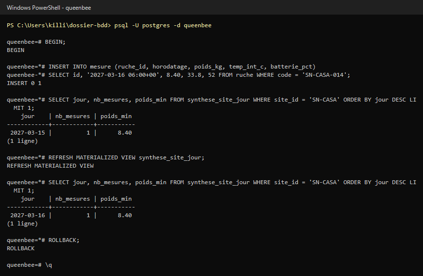

Le vol (8,40 kg) n'apparaît dans la synthèse qu'après le REFRESH.

Si la vue n'est rafraîchie que la nuit, le vol reste invisible jusqu'à 24 h. Il faut donc le détecter sur les mesures brutes, pas dans la synthèse.

### 7.3 L'export pour le bailleur

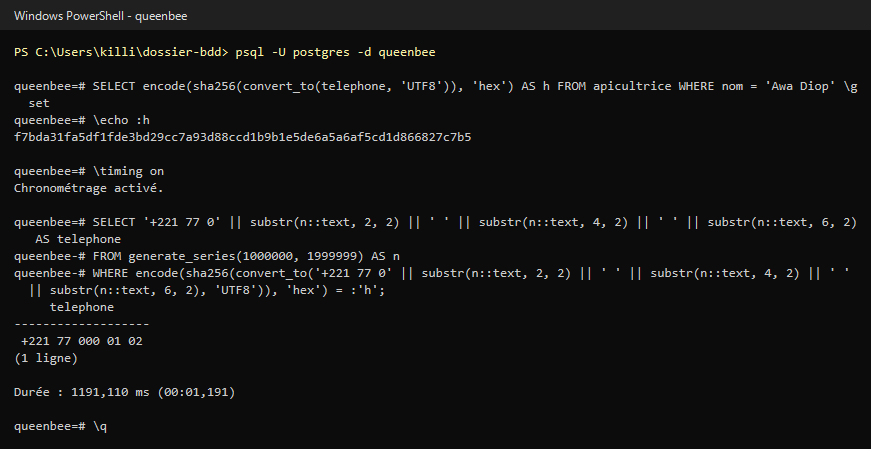

Le téléphone d'Awa Diop est retrouvé à partir de son haché sha256 en 1,2 s.

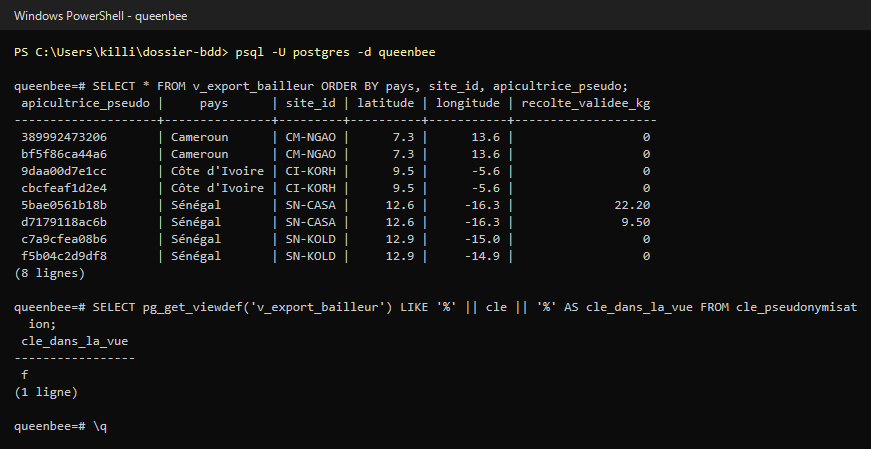

8 lignes pour 11 ruches, sans nom ni téléphone. La clé n'est pas dans la définition de la vue (f).

Colonnes retirées :

- nom et téléphone : ils identifient la personne, et le téléphone permet de la contacter ;

- id de l'apicultrice : remplacé par un HMAC à clé secrète ;

- code de la ruche : il relie la ligne à une ruche, donc à une personne ;

- position exacte : elle mène à la ruche (risque de vol) ; elle est arrondie à 0,1°, soit environ 11 km ;

- date d'installation et détail des mesures : inutiles au bailleur, et utiles pour ré-identifier.

### 7.4 Le journal d'audit

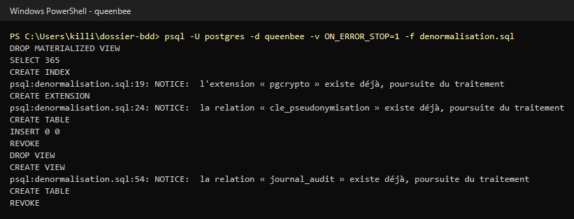

denormalisation.sql est rejouable : le journal et la clé ne sont créés qu'une fois (IF NOT EXISTS), ils ne sont jamais effacés.

1. ligne_id n'est pas une clé étrangère : le journal doit survivre à la suppression de la récolte. Une clé étrangère bloquerait la suppression, ou effacerait la trace avec elle (CASCADE).

2. Recopier les lignes entières est acceptable : c'est une copie figée et datée, jamais modifiée, qui sert de preuve.

3. clock_timestamp() donne l'heure réelle de chaque écriture. now() donne l'heure du début de la transaction, la même pour toutes ses écritures.

### Testez-vous - Lab 7

1. Une vue est recalculée à chaque lecture : elle est toujours à jour, mais lente. Une vue matérialisée stocke son résultat : elle est rapide, mais en retard jusqu'au REFRESH.

2. md5(nom) : sans clé secrète, il se casse avec une liste de noms ; et deux homonymes (les deux Aminata Diop) auraient le même pseudonyme.

3. Oui, l'export est soumis au RGPD : des données pseudonymisées restent personnelles. Avec la clé, ou par recoupement, on peut retrouver la personne.

4. Le journal n'a pas de clé étrangère pour survivre à la suppression de la ligne, et parce qu'il surveille plusieurs tables.

---

# TP Jour 2 - Labs 8 à 10 - Killian Morvan

Notre base du jour 1 est utilisée : f.ba du sujet = awa.diop (Awa Diop, ruche SN-CASA-030), awa.diop du sujet = aminata.diop.casa, coord.sn = m.ndiaye, CI-MAN-012 = SN-KOLD-012, CM-BAF = CI-KORH. Les jetons s'appellent RT-awa.diop-1 à 30.

## Lab 8 - Contraintes, trigger d'audit et rôles

### 8.1 Que se passe-t-il quand on supprime ?

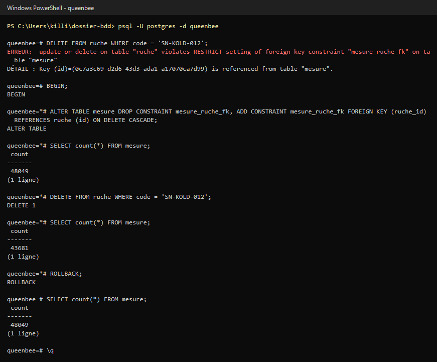

Par défaut, la suppression est refusée par mesure_ruche_fk. En CASCADE (transaction annulée), la ruche part avec ses 4 368 mesures, sans un message : 48 049, puis 43 681. Après le ROLLBACK, tout revient.

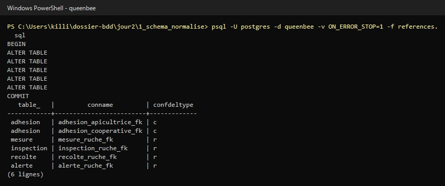

2 CASCADE (adhesion), 4 RESTRICT (mesure, inspection, recolte, alerte).

### 8.2 Refuser les valeurs impossibles

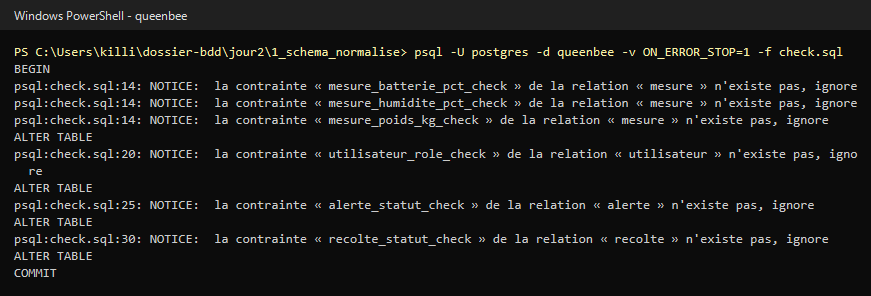

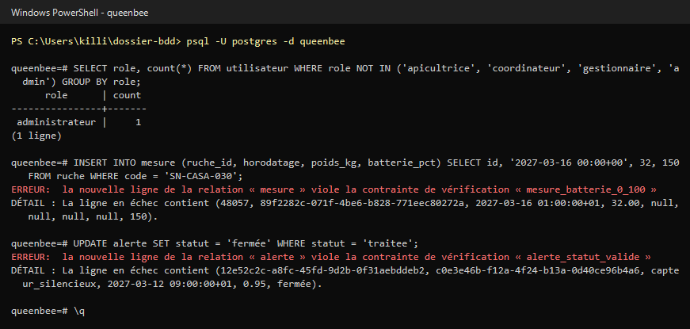

Notre schéma appelle le rôle « administrateur » (et non « admin ») et le statut « refusee » (et non « ecart ») : avec la liste du sujet, l'ALTER serait refusé à cause de cette ligne. On garde donc notre vocabulaire. Les deux tests sont refusés.

### 8.3 Le trigger d'audit

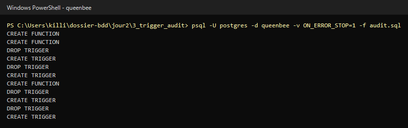

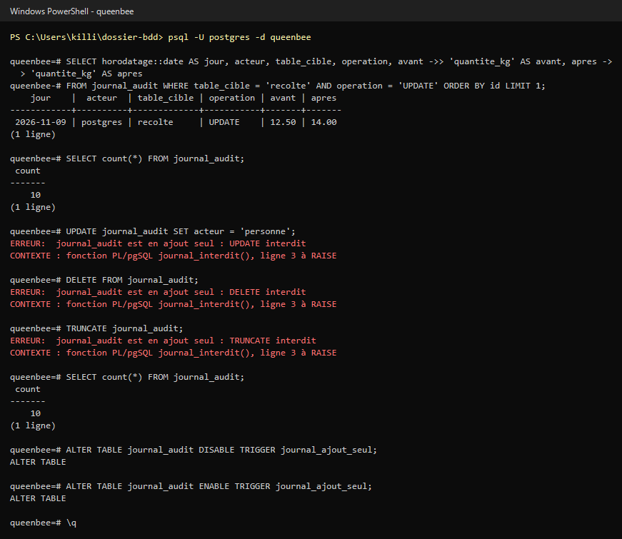

Le journal a bien enregistré la modification du volume (12.50 → 14.00) faite le 9 novembre. UPDATE, DELETE et TRUNCATE sont refusés, et le nombre de lignes ne bouge pas.

Limite : en postgres, DISABLE TRIGGER passe. Le propriétaire peut désactiver la protection : il faut donc aussi copier le journal hors de la base, vers le SIEM.

### 8.4 Les rôles et les vues de moindre privilège

Matrice des droits :

| Objet | apicultrice | coordinateur | gestionnaire | admin |
|---|---|---|---|---|
| ses ruches et leurs mesures | lire | lire (son site) | non | non |
| déclarer une récolte | sur ses ruches | non | non | non |
| valider une récolte | non | sur son site (fonction) | non | non |
| ruches et téléphones de son site | non | lire | non | non |
| synthèse et export | non | non | lire | non |
| comptes utilisateurs | son compte | son compte | son compte | lire, créer, modifier |
| journal d'audit | non | non | non | lire |

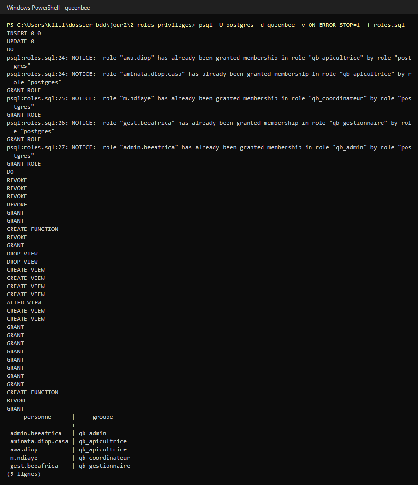

Cinq personnes, chacune dans son groupe. Les rôles n'ont pas de mot de passe : on les teste par SET ROLE en postgres.

### 8.5 et 8.6 La validation, et les tests de contournement

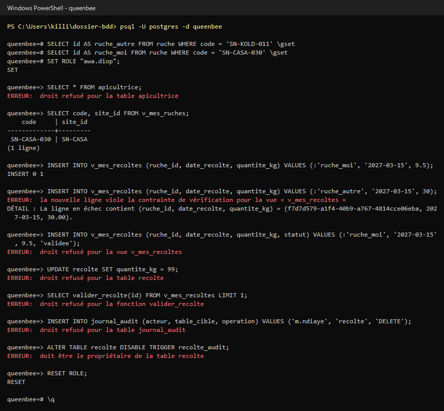

Tests 1 à 9 (awa.diop) : table refusée, ses ruches seulement, sa récolte acceptée, la ruche d'une autre refusée (check option), le statut refusé, UPDATE refusé, valider_recolte refusée, journal refusé, DISABLE TRIGGER refusé.

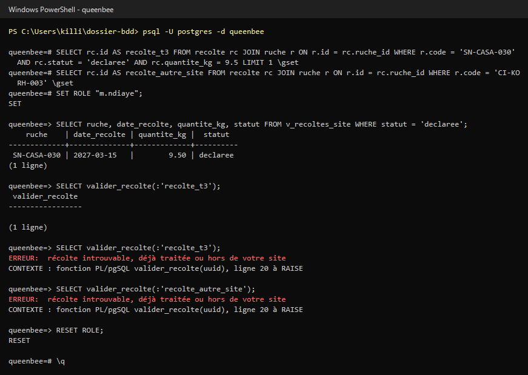

Tests 10 et 11 (m.ndiaye) : la récolte du test 3 est validée, puis refusée la deuxième fois ; la récolte d'un autre site est refusée.

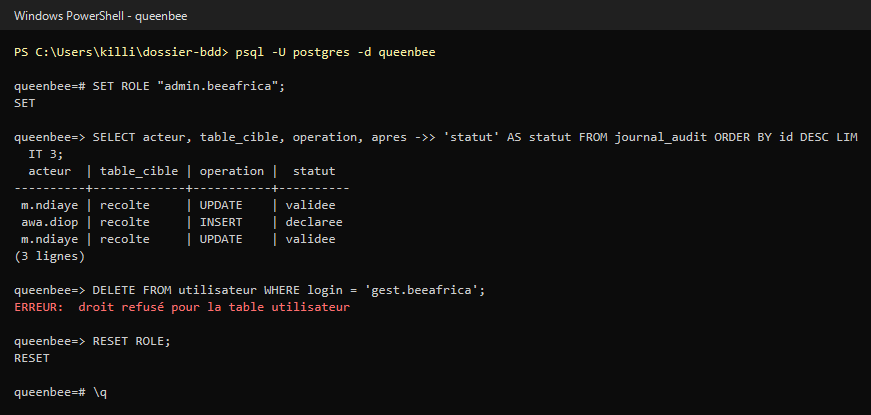

Test 12 (admin.beeafrica) : le journal nomme les vrais acteurs (awa.diop, m.ndiaye), même quand la validation passe par une fonction exécutée avec les droits de postgres. La suppression d'un utilisateur est refusée.

### Testez-vous - Lab 8

1. CASCADE sur mesure.ruche_id efface toutes les mesures d'une ruche en un seul DELETE : la chute de poids qui prouve un vol disparaît.

2. Dans une fonction SECURITY DEFINER de postgres, current_user vaut postgres : le journal accuserait toujours postgres. D'où qui(), qui lit le rôle de la session.

3. Par la vue, l'apicultrice ne peut écrire que sur ses ruches (WITH CHECK OPTION) et que trois colonnes : elle ne peut ni se valider, ni déclarer au nom d'une autre.

4. Sans REVOKE, tout le monde peut appeler valider_recolte, qui s'exécute avec les droits de postgres : seul le contrôle écrit dans la fonction protégerait encore.

## Lab 9 - Transactions

### 9.1 L'action et sa trace ensemble

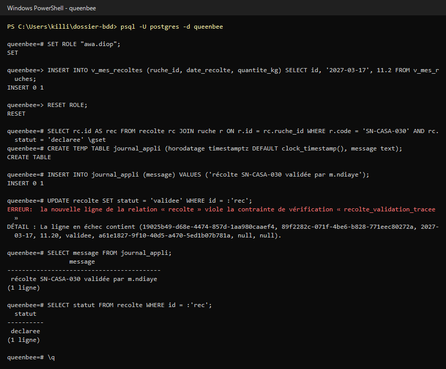

L'UPDATE est refusé par recolte_validation_tracee, mais le journal de l'application affirme la validation : la trace ment.

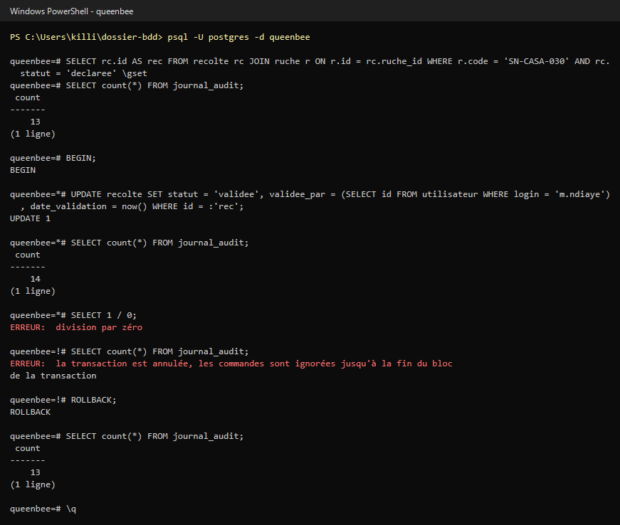

Dans la transaction, le journal passe à +1. Après l'erreur, tout est refusé (transaction annulée). Après le ROLLBACK, tout revient.

### 9.2 La course au jeton, dans deux terminaux

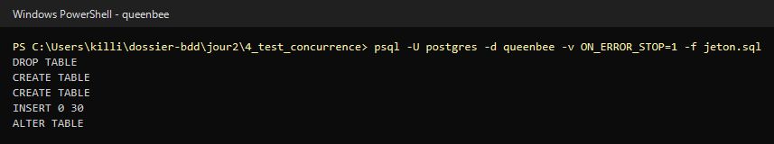

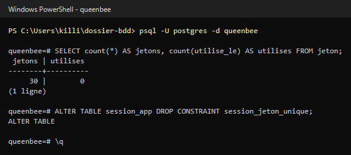

jeton.sql contient déjà la contrainte de l'étape 9.4 : on la retire pour rejouer la course.

| Temps | Terminal A | Terminal B |
|---|---|---|
| T1 | BEGIN |   |
| T2 |   | BEGIN |
| T3 | SELECT : utilise_le vide |   |
| T4 |   | SELECT : utilise_le vide |
| T5 | UPDATE 1 |   |
| T6 | INSERT 0 1 |   |
| T7 | COMMIT |   |
| T8 |   | UPDATE 1 |
| T9 |   | INSERT 0 1 |
| T10 |   | COMMIT |

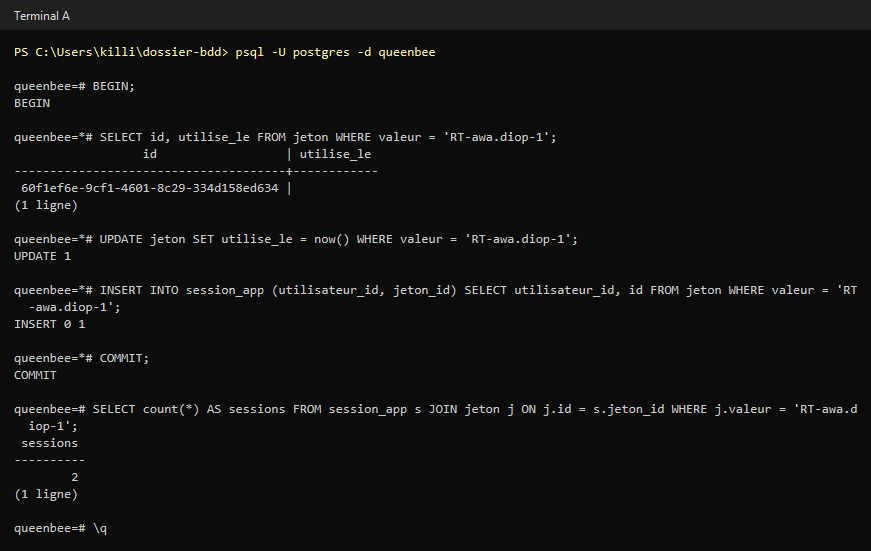

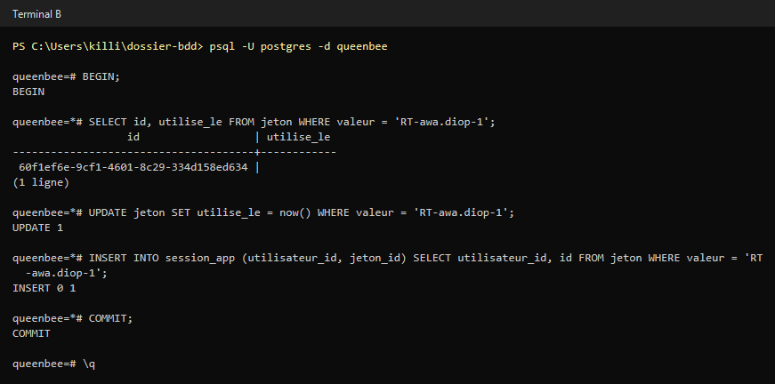

2 sessions avec un seul jeton.

### 9.3 La course par un programme

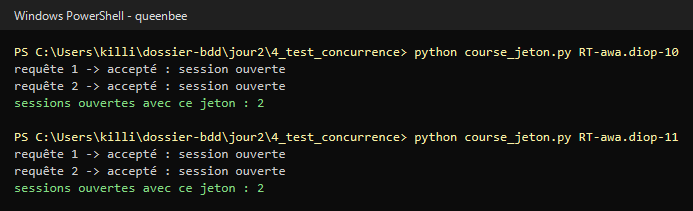

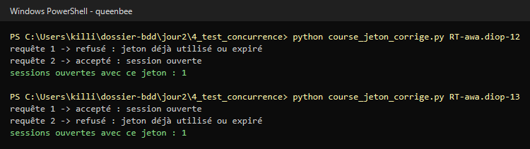

Version vulnérable : 2 sessions à chaque fois. Version corrigée (UPDATE ... RETURNING) : un accepté, un refusé, 1 session.

### 9.4 Les quatre corrections

1. SELECT ... FOR UPDATE : B se fige au T4, puis voit utilise_le rempli dès que A fait COMMIT.

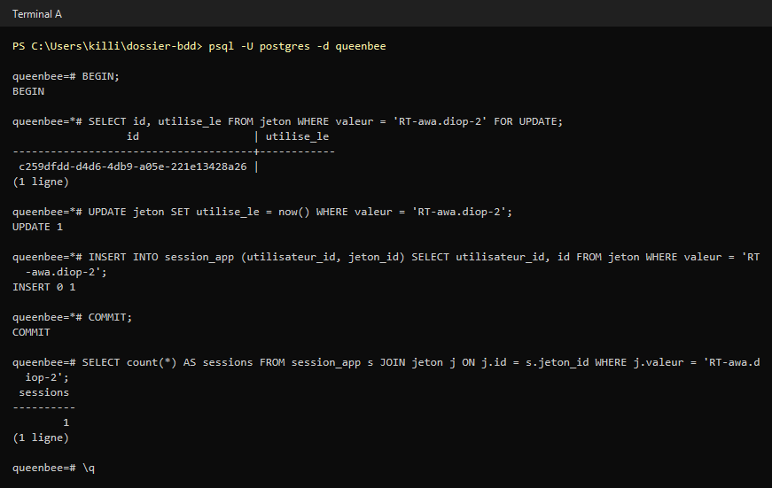

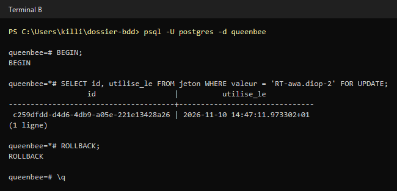

2. UPDATE ... RETURNING : A reçoit un id, B attend puis reçoit UPDATE 0.

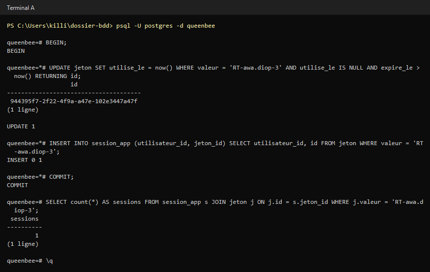

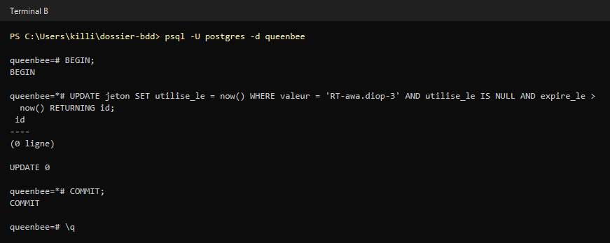

3. UNIQUE (jeton_id) : d'abord refusée à cause des doublons, qu'on supprime en gardant la plus ancienne session ; puis le programme vulnérable n'ouvre plus qu'une session.

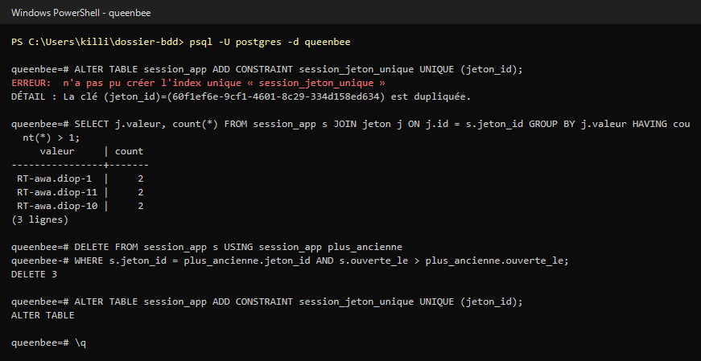

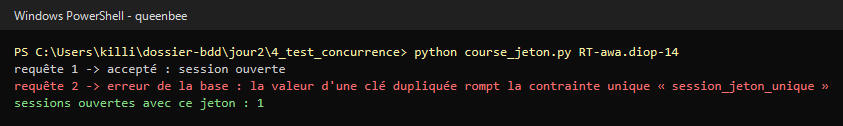

4. REPEATABLE READ : l'UPDATE de B échoue (« n'a pas pu sérialiser un accès »).

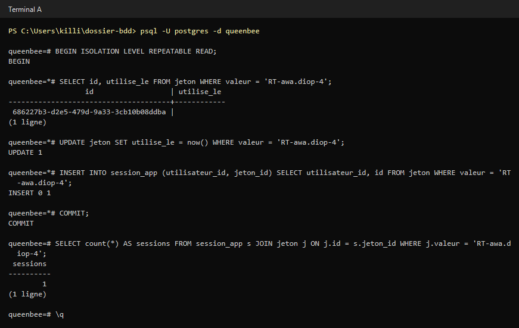

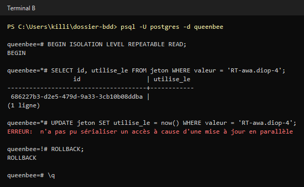

| Correction | Où agit-elle ? | Que voit la seconde requête ? | Avantage | Limite |
|---|---|---|---|---|
| SELECT ... FOR UPDATE | dans le code (verrou) | elle attend, puis voit le jeton utilisé | simple à ajouter | à ne pas oublier dans chaque programme |
| UPDATE ... RETURNING | dans le code (une instruction) | elle attend, puis 0 ligne | sûr et rapide | chaque programme doit l'écrire ainsi |
| UNIQUE (jeton_id) | dans la base | une erreur duplicate key | protège même le code vulnérable | l'erreur doit être gérée |
| REPEATABLE READ | dans la transaction | une erreur de sérialisation | aucune requête à changer | il faut réessayer |

Le trigger du lab 6 est aussi un « vérifier, puis agir » : deux insertions simultanées le contournent.

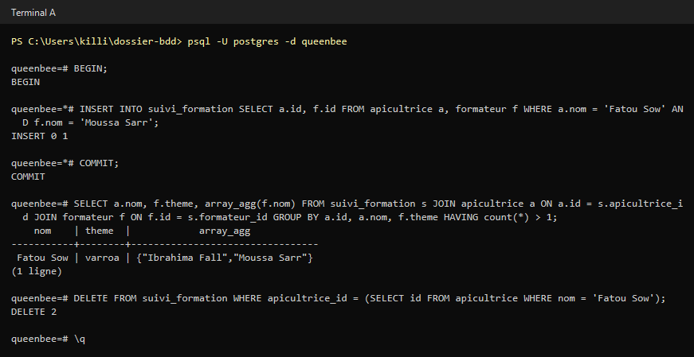

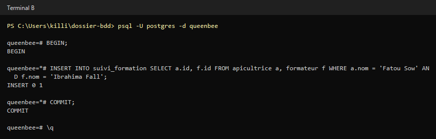

Fatou Sow a deux formateurs varroa. Une contrainte le protégerait : theme recopié dans suivi_formation, avec UNIQUE (apicultrice_id, theme) et une clé étrangère (formateur_id, theme).

### 9.5 Durabilité et sauvegarde

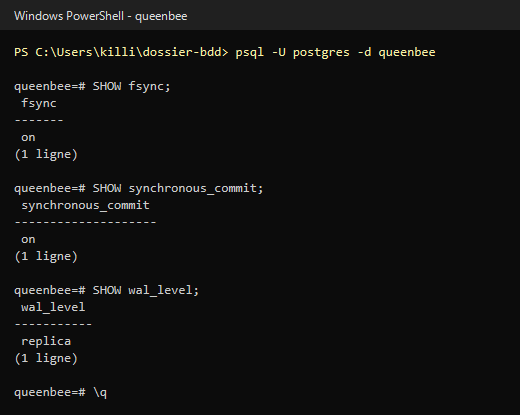

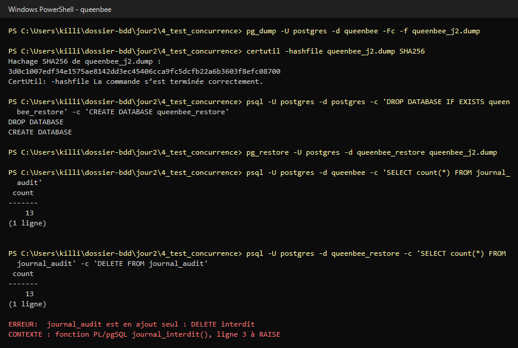

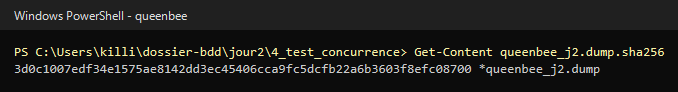

Même empreinte que celle gardée dans le dépôt ; le journal restauré a le même nombre de lignes, et le DELETE y est refusé.

Avec synchronous_commit = off, on perdrait les dernières transactions confirmées en cas de panne.

On garde l'empreinte ailleurs que la sauvegarde : sinon, celui qui modifie la sauvegarde modifie aussi l'empreinte.

pg_dump ne sauvegarde pas les rôles : il faut aussi pg_dumpall --roles-only.

La durabilité protège d'une panne. La sauvegarde protège de la perte du disque, d'une erreur ou d'un rançongiciel.

### Testez-vous - Lab 9

1. Après une erreur, la transaction est annulée et psql affiche queenbee=!#. Il faut taper ROLLBACK.

2. En READ COMMITTED, les deux SELECT voient le jeton libre avant que l'un ne valide : rien ne relie la vérification à l'action.

3. L'UPDATE verrouille la ligne ; quand A valide, la condition utilise_le IS NULL est réévaluée pour B : 0 ligne.

4. ACID ne protège pas d'un rançongiciel. Ce qui protège : des sauvegardes hors du serveur, testées, avec leur empreinte.

## Lab 10 - Revue de sécurité

### 10.1 L'injection par le tri

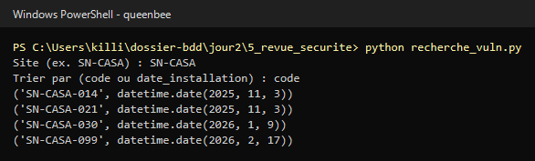

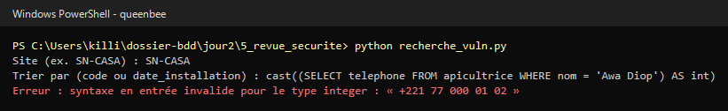

Par erreur : le téléphone d'Awa Diop apparaît dans le message de la base.

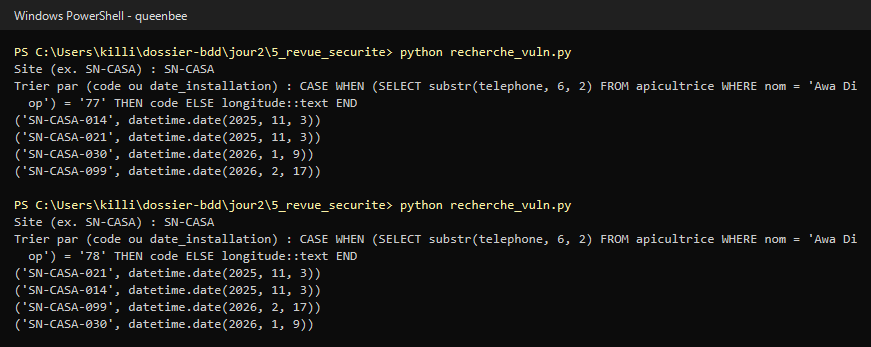

À l'aveugle : avec « 77 » le tri se fait par code, avec « 78 » par longitude. L'ordre répond oui ou non.

Empilée : refusée, une requête paramétrée ne contient qu'une commande.

recherche.py (liste blanche, sql.Identifier) : le tri inconnu est refusé, le tri normal marche.

### 10.2 La vue qui en dit trop

Avant correction (état remis dans une transaction annulée) : la table est refusée, mais la vue de carte montre les 11 ruches avec tous les téléphones ; l'espion ne renvoie qu'une ligne, mais ses NOTICE donnent la position des 11 ruches.

Après corrections.sql : une seule ligne sans téléphone, l'espion ne voit plus que SN-CASA-030, et dans une nouvelle session la fonction temporaire est refusée.

### 10.3 Auditer notre base

C1 : 0 fonction exécutable par PUBLIC. C2 : les 3 fonctions SECURITY DEFINER fixent leur search_path. C3 : les 7 vues filtrantes sont des barrières. v_export_bailleur ne filtre pas par utilisateur et n'est donnée qu'au gestionnaire ; v_ruche_coordinateur (jour 1) n'est donnée à personne.

C4 : chaque rôle ne voit que son périmètre.

C5 : trois refus. C6 : le journal nomme admin.beeafrica. C7 : refus par la check option. C10 : les 4 preuves sont en RESTRICT (r).

C8 : 1 session.

C9 : seuls les deux scripts volontairement vulnérables construisent une requête par +. C11 : le mot « password » n'apparaît que dans des explications, aucun secret.

C12 : la base se reconstruit avec nos fichiers dans une base vide (code 0 partout, seulement les refus voulus).

Retests des constats : R1, le compte qb_recherche ne lit que la ruche, l'attaque est refusée ; R2, une nouvelle fonction n'est plus ouverte à PUBLIC (0 ligne) ; R3, PUBLIC n'a plus de droit sur la base ; R4, une ruche ne peut plus changer de site sans son apicultrice. R5 (C4) : le gestionnaire lit l'export, mais pas la clé.

| ID | Gravité | Constat | Correction |
|---|---|---|---|
| P1 | haute | injection par le tri | liste blanche et sql.Identifier |
| P2 | critique | vue de carte trop large | vue réécrite, security_barrier |
| P3 | critique | fuite par fonction espion | security_barrier, REVOKE TEMPORARY |
| R1 | haute | scripts connectés en superutilisateur | compte qb_recherche minimal |
| R2 | moyenne | nouvelles fonctions ouvertes à PUBLIC | ALTER DEFAULT PRIVILEGES |
| R3 | basse | nom de la base écrit en dur | current_database() |
| R4 | haute | ruche sur un autre site que son apicultrice | clé étrangère composée |
| R5 | moyenne | le gestionnaire ne lisait pas l'export | GRANT EXECUTE sur hmac |

### Testez-vous - Lab 10

1. ORDER BY %s envoie une valeur, pas un nom de colonne : on trie par une constante, l'ordre ne change pas.

2. Non : l'attaque par erreur et l'attaque à l'aveugle passent quand même.

3. security_barrier : le filtre de la vue passe avant les conditions de l'utilisateur. security_invoker : la vue s'exécute avec les droits de celui qui la lit.

4. Critique : la vue v_carte_ruches d'origine. Haute : une fonction SECURITY DEFINER sans search_path. Basse : un README absent.

## 11 - Rendu

Le schéma complet est exporté dans jour2/1_schema_normalise/schema_j2.sql, les fichiers sont rangés dans jour2/, et le README explique comment reconstruire la base. La reconstruction dans une base vide est montrée par le contrôle C12 ci-dessus.
